# Seat Reservation module dependencies

This diagram shows the current Seat Reservation and shared Operation modules,
plus their direct dependencies and dependents. Arrows point from a module to a
production import, including re-exports.

Neighbor dependencies are shown only where they connect back to a Seat Reservation
or shared Operation module. Common `std`, `aws` configuration,
Lambda runtime and test-only imports are omitted. Build scripts, shell wrappers,
cloud resources and runtime message flow are outside this source-module view.

```mermaid
flowchart TB
    subgraph SEAT["Seat Reservation modules"]
        Submit["seat_reservation_processor.zig"]
        Complete["seat_reservation_completion_processor.zig"]
        Seat["seat_reservation.zig"]
        Persist["seat_reservation_persistence.zig"]
        Cache["seat_event_cache.zig"]
        Counter["ledger_counter.zig"]
        EventsCLI["seat_events_cli.zig"]
        CounterCLI["ledger_counter_cli.zig"]
    end

    subgraph SHARED["Shared Operation modules"]
        Message["processor_message.zig"]
        OpPersist["operation_persistence.zig"]
        Intake["intake_lambda.zig"]
        Native["tiger_beetle_processor.zig"]
        Generic["tiger_beetle_completion_processor.zig"]
        QueueCLI["queue_cli.zig"]
    end

    subgraph NEIGHBORS["Direct dependencies / dependents"]
        Operation["operation.zig"]
        Queue["sqs_queue.zig"]
        Auth["lambda_auth.zig"]
        TB["tigerbeetle.zig"]
        Query["query_lambda.zig"]
        PersistenceCLI["persistence_cli.zig"]
        Dynamo["dynamodb SDK module"]
    end

    Submit --> Seat
    Submit --> Persist
    Submit --> Counter
    Submit --> Message
    Submit --> Operation
    Submit --> Queue
    Submit --> Dynamo
    Complete --> Submit
    Complete --> Seat
    Complete --> Persist
    Complete --> Message
    Complete --> OpPersist
    Complete --> Operation
    Complete --> Dynamo
    EventsCLI --> Seat
    EventsCLI --> Persist
    CounterCLI --> Counter
    Persist --> Seat
    Persist --> Cache
    Persist --> OpPersist
    Persist --> Operation
    Persist --> Dynamo
    Cache --> Seat
    Cache --> Operation
    Counter --> Dynamo
    Seat --> Operation
    Seat --> Message

    Message --> Operation
    OpPersist --> Operation
    OpPersist --> Dynamo
    Intake --> Message
    Intake --> OpPersist
    Intake --> Operation
    Intake --> Queue
    Intake --> Auth
    Native --> Message
    Native --> Operation
    Native --> Queue
    Native --> TB
    Generic --> Message
    Generic --> OpPersist
    Generic --> Operation
    QueueCLI --> Message
    QueueCLI --> Operation
    QueueCLI --> Queue

    Query --> OpPersist
    PersistenceCLI --> OpPersist
```

`query_lambda.zig` and `persistence_cli.zig` appear because they directly depend on
`operation_persistence.zig`. Seat completion imports the submission module for
shared SQS event parsing, batch response encoding and diagnostics. Event persistence
re-exports `ReadyCache` from `seat_event_cache.zig`; both seat processors access the
cache through Event persistence.
The native processor uses the shared envelope but does not depend on seat modules.

See the [Seat Reservation reference](SEAT_RESERVATION.md#implementation-boundaries)
for module responsibilities and behavior.
