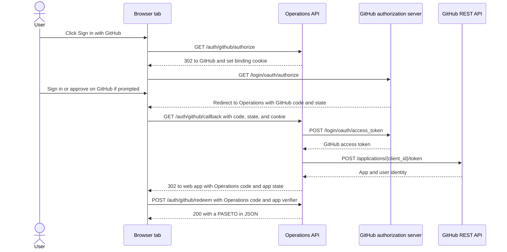

# Browser sign-in with GitHub

The web app starts one GitHub OAuth authorization-code flow, then redeems a
separate Operations code for a PASETO. GitHub authenticates the user and
authorizes the Operations OAuth App. Operations verifies the user's GitHub
identity and issues the credential used to submit and query Operations.
[Browser sign-in contract](API_GATEWAY.md#browser-github-sign-in)

## Actors and callback URLs

| Actor | Role |
| --- | --- |
| User | Signs in to GitHub and approves the OAuth App if prompted. |
| Browser tab and web app | The browser follows redirects and manages cookies. The web app's JavaScript tracks the local attempt and later uses the PASETO. |
| Operations API | API Gateway routes the sign-in requests to the Authentication Lambda, which acts as the GitHub OAuth client and signs the PASETO. |
| GitHub authorization server (`github.com`) | Authenticates the user, handles consent, and issues the GitHub authorization code and access token. |
| GitHub REST API (`api.github.com`) | Checks the GitHub access token and returns its app and user identity. |
| DynamoDB and Secrets Manager | DynamoDB tracks Pending Sign-ins across Lambda invocations. Secrets Manager supplies the GitHub client secret and PASETO signing key to the Lambda. |

The example uses `https://api.example.com` for Operations and
`https://app.example.com` for the web app. The two redirects have different
destinations and registrations.

| Redirect | Example callback | Configuration |
| --- | --- | --- |
| GitHub sends the browser to Operations | `https://api.example.com/auth/github/callback` | Register the URL in the GitHub OAuth App and set the same URL as Operations' `GITHUB_OAUTH_CALLBACK_URL`. |
| Operations sends the browser to the web app | `https://app.example.com/sign-in.html` | Include the exact URL, with any static query, in Operations' `GITHUB_BROWSER_REDIRECT_URIS`. |

GitHub uses its registration to check the `redirect_uri` requested by Operations.
Operations makes its own check of the app callback. For cross-origin API calls,
`OPERATIONS_BROWSER_ORIGINS` separately lists the app's origin, such as
`https://app.example.com`. [Deployment settings](DEPLOY_AWS_LAMBDA_WITH_SAM.md#browser-sign-in-and-cors)

## Request sequence

## Start sign-in in the browser

1. **The web app prepares its attempt.** On click, the app's JavaScript
   generates random app state and a separate PKCE verifier. It saves them in
   `sessionStorage` so they survive navigation in the same tab. The state lets
   the app correlate the return with the attempt it just started. The
   verifier stays in the tab while the app sends its `S256` challenge, the
   base64url-encoded SHA-256 hash of the verifier. Operations uses that
   challenge to verify the app's proof later.
   [Browser caller example](API_GATEWAY.md#browser-caller-example)

2. **The browser opens the Operations authorization endpoint.** The app
   navigates the tab to `GET /auth/github/authorize` with the app callback as
   `redirect_uri`, the app state, the PKCE challenge, and
   `code_challenge_method=S256`. Operations checks the exact callback against
   its registration before starting a Pending Sign-in. This limits where it
   can send the result.
   [Authorization handler](../src/browser_sign_in.zig#L45)

3. **Operations prepares the GitHub leg and redirects the browser.** The
   Authentication Lambda generates a separate GitHub state and PKCE verifier.
   It encodes 32 random bytes as a 64-character lowercase hexadecimal string
   and sends that string to GitHub as the OAuth `state` parameter. It hashes
   the ASCII bytes of that string with SHA-256 and stores the resulting
   64-character lowercase hexadecimal digest as the DynamoDB partition key
   (`id`) for the Pending Sign-in. The item also holds Operations' PKCE
   verifier, a separate digest of the binding cookie value, and the app's
   callback, state, and challenge. DynamoDB keeps these values available after
   the `/authorize` invocation ends. The browser's later `/callback` request
   starts a separate invocation that can load the item even if it runs in a
   different Lambda execution environment.
   The `302` sets a Secure, HttpOnly, SameSite=Lax binding cookie on the
   Operations host and points the browser at GitHub. The GitHub request also
   includes the OAuth App's public Client ID, the **Operations callback** as
   `redirect_uri`, and the `S256` challenge derived from Operations' verifier.
   Operations requests zero scopes because it needs the account's numeric ID.
   [Pending Sign-in key derivation](../src/pending_sign_in.zig#L115)
   [GitHub authorization request](../src/github_identity.zig#L74)

4. **GitHub returns the browser to Operations.** GitHub uses its own session
   or prompts for sign-in, then asks for approval if needed. It checks the
   requested callback against the OAuth App's registration. On approval,
   GitHub redirects to the Operations callback with a short-lived authorization
   code and the GitHub state. The **browser** makes the callback GET and
   attaches the binding cookie. Starting on the same Operations hostname as
   the callback lets the browser return the host-bound cookie.
   [GitHub authorization-code flow](https://docs.github.com/en/apps/oauth-apps/building-oauth-apps/authorizing-oauth-apps#web-application-flow)

## Verify identity with GitHub

5. **Operations validates and claims the callback.** The Lambda hashes the
   returned OAuth `state` the same way to look up the Pending Sign-in. It
   checks the binding cookie against the stored cookie digest to verify that
   the callback came from the initiating browser. It also checks the
   registered app callback and ten-minute sign-in deadline. To claim the
   attempt, the Lambda uses a conditional DynamoDB write that succeeds only
   while the item is pending and unexpired. Duplicate callbacks are rejected,
   so at most one callback can exchange the GitHub code.
   [Callback handler](../src/browser_sign_in.zig#L97)

6. **Operations exchanges the GitHub code, then checks the token.** The
   Lambda reads the GitHub client secret from Secrets Manager. It makes a
   direct HTTPS request to `github.com/login/oauth/access_token` with the
   GitHub code, Client ID and secret, Operations callback, and its own PKCE
   verifier. The client secret authenticates the OAuth App. The verifier
   proves possession of the secret used to create the original challenge.

   GitHub returns a GitHub access token. Operations makes a second direct
   request, this time to `api.github.com/applications/{client_id}/token`, using
   the app credentials to check that token. It verifies the returned app
   identity and uses the numeric `user.id` to derive the Operation Tenant
   `github:<id>`. Operations discards the GitHub access token once it has the
   tenant.
   [Code exchange](../src/github_identity.zig#L231),
   [Tenant resolution](../src/github_identity.zig#L309),
   [GitHub token-check endpoint](https://docs.github.com/en/rest/apps/oauth-applications#check-a-token)

## Finish sign-in in the web app

7. **Operations redirects to the web app with a new code.** The Lambda records
   an approved Pending Sign-in for a single-use Operations code. It binds the
   code to the registered app callback, the app's PKCE challenge, and the
   verified tenant. The code expires after at most 60 seconds and stays within
   the original sign-in deadline. Operations clears the binding cookie and
   redirects the browser to the app callback with this code and the **app
   state** from step 1. The short-lived code can travel in the URL while the
   PASETO is delivered separately in an HTTPS response body. If the user denies
   access at GitHub, Operations returns `error=access_denied` with the app state.
   [Callback completion](../src/browser_sign_in.zig#L152),
   [Browser sign-in contract](API_GATEWAY.md#browser-github-sign-in)

8. **The web app redeems the Operations code.** The app reads and clears the
   saved attempt, removes the sign-in parameters from the address bar, and
   checks the returned state against the value from its tab. On approval, it
   calls `POST /auth/github/redeem` with the Operations code, the exact app
   callback, and the **app's original PKCE verifier**. Operations checks the
   callback and expiry, hashes the verifier and compares it with the saved
   challenge. The Lambda reads the PASETO signing key from Secrets Manager,
   conditionally consumes the code, and returns the signed token in JSON.
   For a separately hosted app, API Gateway uses CORS to allow the configured
   app origin to read that response.
   [Redemption handler](../src/browser_sign_in.zig#L210),
   [Cross-origin requests](API_GATEWAY.md#cross-origin-requests)

9. **The web app calls the Operations API.** The app keeps the PASETO in
   memory and sends it as `Authorization: Bearer …` on submission and query
   requests. Intake and Query verify its signature and expiry using the
   deployed public key, then derive the Operation Tenant from the signed
   `sub` claim. The PASETO lasts eight hours by default. Reloading the example
   app or signing out locally clears its in-memory copy.
   [API authorization](API_GATEWAY.md#authentication-and-tenant-authorization),
   [Credential lifetime](adr/0009-external-identity-providers.md#credential-exchange-and-lifetime)
